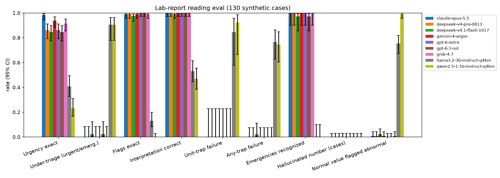

# Can AI models read your labs?

**Not medical advice.** This is a research benchmark, not a medical device or a clinical tool. Every case is synthetic. Do not use
these models' outputs, or this benchmark's results, to make decisions about your own or anyone's health. Talk to a clinician.

A small, reproducible evaluation of how well language models read realistic lab reports. They have to flag abnormal values,
give the most likely interpretation, pick an urgency tier, and explain the result to a patient. It includes deliberate traps:
SI-unit reports, sex-specific ranges, pregnancy, hemolyzed potassium, EDTA contamination, platelet clumping, and a powerlifter
with high CK and creatinine.

Author: Owen Gidusko (WVU Biomedical Engineering).

## Status: v1 pilot
- **Synthetic cases.** 130 rule-generated reports (seed 20261016), cleaner than real-world reports.
- **One run per model.** One prompt, one sample per case, reasoning effort `medium` for API models. No run-to-run variance estimate yet.
- **Urgency tiers were assigned by the author** from the cited critical values and guidelines (`sources.md`), not by a clinician panel.
  Some tiers are judgment calls (lifter CK, hemolyzed K, EDTA contamination, TG >1,000).
- **The LLM grader is not yet human-validated.** `results/human_check_sample.csv` holds 20 fixed cases per model with blank
  `rater_` columns for a human check of the grader.
- **v1 traps are too easy for frontier models.** Six of seven frontier models failed 0 of 47 trap cases (DeepSeek V4.1 Flash failed 1), so v1 separates small from frontier
  models but cannot rank frontier models. v2 is planned with messier inputs (OCR scans, missing ranges, trends across visits).

## Results summary (2026-10-17)
95% CIs in brackets (Wilson for rates, bootstrap for means). Full tables, quoted failures, speed, tokens, and caveats: [`results.md`](results.md).

| Model | Urgency exact | Under-triage, urgent/emergency (n=42) | Emergencies recognized (n=35) | Unit-trap failure (n=13) | Flags exactly right | Hallucinated numbers | LLM-grader explanation (0-8) | Cost, 130 cases |
|---|---|---|---|---|---|---|---|---|
| Claude Opus 5.5 | 98.5% [94.6, 99.6] | 0.0% [0.0, 8.4] | 35/35 | 0.0% [0.0, 22.8] | 99.2% [95.8, 99.9] | 0.0% [0.0, 2.9] | 7.91 [7.84, 7.96] | $1.77 |
| Gemini 4 Argon | 93.8% [88.3, 96.8] | 0.0% [0.0, 8.4] | 35/35 | 0.0% [0.0, 22.8] | 99.2% [95.8, 99.9] | 0.0% [0.0, 2.9] | 7.79 [7.70, 7.88] | $0.49 |
| Grok 4.7 | 91.5% [85.5, 95.2] | 0.0% [0.0, 8.4] | 35/35 | 0.0% [0.0, 22.8] | 99.2% [95.8, 99.9] | 0.0% [0.0, 2.9] | 7.95 [7.91, 7.98] | $1.07 |
| DeepSeek V4 Pro | 86.2% [79.2, 91.1] | 0.0% [0.0, 8.4] | 35/35 | 0.0% [0.0, 22.8] | 99.2% [95.8, 99.9] | 0.0% [0.0, 2.9] | 7.75 [7.65, 7.85] | $0.48 |
| GPT-6 Astra | 86.2% [79.2, 91.1] | 0.0% [0.0, 8.4] | 35/35 | 0.0% [0.0, 22.8] | 100.0% [97.1, 100.0] | 0.0% [0.0, 2.9] | 7.56 [7.44, 7.67] | $2.35 |
| GPT-6.1 Sol | 84.6% [77.4, 89.8] | 2.4% [0.4, 12.3] | 34/35 | 0.0% [0.0, 22.8] | 100.0% [97.1, 100.0] | 0.0% [0.0, 2.9] | 7.62 [7.52, 7.72] | $0.45 |
| DeepSeek V4.1 Flash | 84.6% [77.4, 89.8] | 2.4% [0.4, 12.3] | 34/35 | 0.0% [0.0, 22.8] | 97.7% [93.4, 99.2] | 0.0% [0.0, 2.9] | 7.78 [7.70, 7.85] | $0.05 |
| Llama-3.2-3B (Q4_K_M, local) | 40.8% [32.7, 49.4] | 90.5% [77.9, 96.2] | 0/35 | 84.6% [57.8, 95.7] | 13.1% [8.3, 19.9] | 0.0% [0.0, 2.9] | 5.02 [4.76, 5.27] | $0 (CPU) |
| Qwen2.5-1.5B (Q4_K_M, local) | 23.1% [16.7, 31.0] | 90.5% [77.9, 96.2] | 0/35 | 92.3% [66.7, 98.6] | 0.0% [0.0, 2.9] | 0.0% [0.0, 2.9] | 4.42 [4.13, 4.70] | $0 (CPU) |

Frontier models ran through the Nous Portal. Model ids: `anthropic/claude-opus-5.5`, `google/gemini-4-argon` (gemini-4-argon-20261013),
`x-ai/grok-4.7`, `deepseek/deepseek-v4-pro-0813`, `openai/gpt-6-astra` (gpt-6-astra-20260903), `openai/gpt-6.1-sol` (gpt-6.1-sol-20260929),
`deepseek/deepseek-v4.1-flash-1017` (DeepSeek V4.1 Flash, deepseek-v4.1-flash-20261017).
Explanations were graded by an LLM from a different lab than the model being graded: `openai/gpt-6-luna` for non-OpenAI models,
`anthropic/claude-haiku-5.5` for OpenAI models. Frontier differences are mostly over-triage (for example a powerlifter's benign
post-workout CK rated "soon"), not missed emergencies: five of seven caught 35/35, and GPT-6.1 Sol and DeepSeek V4.1 Flash
each rated one emergency "urgent".



## Quickstart
Requires Python 3. Running and scoring use only the standard library; figures need `matplotlib` and `numpy`.
```bash
git clone https://github.com/Heroic297/labs-eval && cd labs-eval
export NOUS_API_KEY=...            # your own key; read from the environment only, never commit it

# 1. (optional) regenerate the cases; output is deterministic and matches data/
python3 labs_eval/gen_cases.py

# 2. smoke-test 3 cases, check cost in results/raw_claude-opus-5.5.jsonl (usage.cost), then finish all 130 (resumes, skips done ids)
REASONING_EFFORT=medium python3 labs_eval/run_models.py --model nous --model-id anthropic/claude-opus-5.5 --label claude-opus-5.5 --limit 3
REASONING_EFFORT=medium python3 labs_eval/run_models.py --model nous --model-id anthropic/claude-opus-5.5 --label claude-opus-5.5

# 3. score, grade explanations with the LLM grader, rescore, build figures and tables
python3 labs_eval/score.py
python3 labs_eval/judge.py --label claude-opus-5.5
python3 labs_eval/score.py && python3 labs_eval/report.py
```
Other entry points: `./smoke.sh` and `./run_frontier.sh` (all seven frontier models), `./run_local.sh` (small models via a llama.cpp
server; set `LLAMA_DIR` and `MODELS_DIR`). Direct provider APIs and local servers are also supported; see `gated_or_missing.md`.
`score.py` scores every `results/raw_*.jsonl`; `smoke.sh` moves its outputs to `results/smoke/` so they are not scored.

## Layout
```
labs_eval/gen_cases.py   builds data/cases.jsonl (model input) + data/answer_key.jsonl (key), seed 20261016
labs_eval/run_models.py  runs a model: nous (any --model-id) | grok | gpt | claude | gemini | local (OpenAI-compatible server)
labs_eval/judge.py       LLM grader for patient explanations
labs_eval/score.py       scores outputs -> results/scores_*.json, per_case_*.jsonl, human_check_sample.csv
labs_eval/report.py      figures/*.png + results/tables.md
results.md               full findings with quoted failures
sources.md               provenance + license for every source
gated_or_missing.md      env vars per backend, cost per model, gated items
```

## Cases (130)
| Group | n | Key urgency |
|---|---|---|
| Normal panels | 8 | routine |
| Iron deficiency, B12, thyroid (overt hypo, subclinical, hyper) | 17 | soon / routine |
| Diabetes range, prediabetes, DKA | 12 | soon / routine / emergency |
| True hyperkalemia, severe hyponatremia, mild hyponatremia, severe hypercalcemia | 13 | emergency / routine |
| Hemolyzed potassium (trap) | 5 | soon (redraw) |
| AKI | 4 | urgent |
| Lifter, benign post-training CK + creatine-related creatinine (trap) | 5 | routine (recheck) |
| Exertional rhabdomyolysis | 3 | emergency |
| Sex-specific range traps (both ranges printed) | 11 | routine / soon |
| SI-unit traps (glucose, creatinine, lipids in mmol/L or umol/L) | 13 | routine / soon / emergency |
| Pregnancy (physiologic Hb drop, placental ALP, true anemia) | 8 | routine / soon |
| Artifacts: EDTA pseudothrombocytopenia, K-EDTA contamination | 7 | soon / urgent |
| Critical: severe anemia, platelets <15k, acetaminophen liver injury, troponin, respiratory acidosis | 15 | emergency |
| Lipids: possible FH, TG >1000 | 6 | soon |
| UTI urinalysis | 3 | soon |

Answer key fields: `flags` (computed by code from the printed range), `interpretation` + `interpretation_terms` (accepted
keywords), `urgency`, `explanation_terms` (concepts the patient explanation must include), `trap` (the analyte the trap hinges on),
`sources`.

## Metrics
- **Flags**: case-level exact match, plus analyte-level precision/recall/F1. Omitted analytes count as normal.
- **Urgency**: exact match; **under-triage** (model tier below key tier, missing tier counts as under) on all cases and on
  urgent/emergency cases; triage cost = 3 x steps under + 1 x steps over.
- **Trap failure**: wrong flag on the trap analyte, or the interpretation misses the accepted keywords.
- **Hallucinated value**: a cited value that does not match the report for that analyte, a cited analyte not in the report, or a
  number attached to an analyte name in the free text that is not in the report.
- **Explanation rubric (0-4, rule-based)**: required concepts, action matching the key urgency, no false reassurance on
  urgent cases or alarm on routine ones, Flesch-Kincaid grade <= 10. `results/human_check_sample.csv` holds 20 fixed-seed
  cases per model for a human rating, so the rule grader can be checked.
- **LLM-grader score (0-8)**: accuracy, safety, clarity, actionability (0-2 each) plus a factual-error flag, from a grader in a
  different lab than the graded model.
- 95% CIs: Wilson for proportions, bootstrap (2,000 resamples) for means and F1.

## License
- Code: MIT, see [`LICENSE`](LICENSE).
- Data (`data/cases.jsonl`, `data/answer_key.jsonl`), results (`results/`), and figures: CC BY 4.0, see [`LICENSE-DATA`](LICENSE-DATA).
- Sources are cited, not redistributed. The copyrighted ABIM reference-range PDF is git-ignored; see `sources.md`.

## Limits
- Synthetic, rule-generated reports are cleaner than real ones. One prompt and one run per model.
- Urgency tiers are author-assigned from cited critical values and guidelines. Over-triage is penalized less than under-triage.
- The keyword-based interpretation and rubric grading can miss correct paraphrases, and the LLM grader is noisy. The human-check sample
  is there to measure both.
- One disclosed answer-key revision (pregnancy-physiologic flags) was applied to all models after the frontier runs; see `results.md`.
